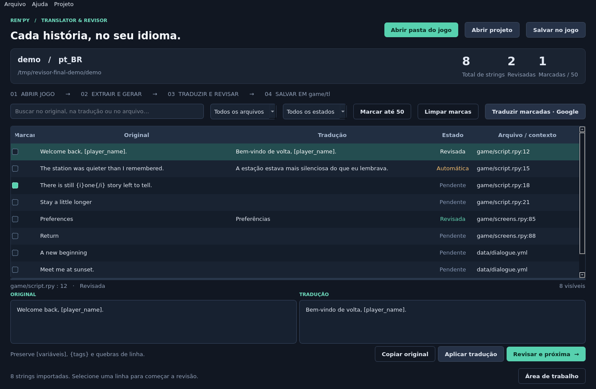

# Ren'Py Translator & Revisor

Um programa desktop em português para traduzir e revisar jogos Ren'Py. Inspirado no fluxo do [The Sims 4 Translator, de voky1](https://github.com/voky1/sims4-translator): tabela com original e tradução, busca, estados de revisão e sugestões automáticas. A implementação é independente, voltada aos formatos e ao sistema de tradução do Ren'Py.

## O que faz

- Abre a **pasta base do jogo**, onde ficam o executável e a subpasta `game`.
- Extrai todo o conteúdo dos `.rpa` e decompila `.rpyc`/`.rpymc` com o **SRT v1.1 enviado**, incluído no programa. A extensão usual é `.rpyc`, não `.rpcy`.
- Usa o motor do próprio jogo, ou um SDK compatível, para gerar os blocos nativos de tradução. Preserva os IDs reais dos diálogos, personagens, atributos e comandos; não trata todos os diálogos como simples pares `old`/`new`.
- Pergunta se deseja incluir `.yml` e `.yaml`. Inclui os valores textuais de mapas/listas, mantendo as chaves e os demais tipos.
- Oferece busca por texto/arquivo, filtro por estado, editor lado a lado e **Revisar e próxima**.
- Traduz pelo Google **uma string por requisição**, em sequência, com **até 50 marcadas por lote**. Protege `[variáveis]`, `{tags}`, marcadores de formatação e quebras de linha. Sugestões automáticas ficam pendentes de revisão.
- Salva a tradução diretamente em `game/tl/<idioma>/`, sem alterar os scripts ou arquivos RPA originais. Strings pendentes continuam com o texto original.
- Salva projetos `.rpt.json` para retomar o trabalho. Exportações seguintes fazem backup e detectam conflitos com edições externas ou outras traduções.



## Executar no Windows

Requisitos: **Python 3.12 de 64 bits recomendado** (suporte a Python 3.11–3.14 convencional), Windows 10/11 de 64 bits e um jogo Ren'Py com seu motor funcional. Python 3.15 e versões free-threaded ainda não são suportados. O executável do jogo não é incluído neste projeto.

Depois de baixar/clonar o projeto, abra `scripts/start_windows.bat`. O instalador reutiliza uma `.venv` compatível ou procura Python 3.12, 3.13, 3.14 e 3.11, nessa ordem. Se o ambiente existente for incompatível, ele é preservado em `.venv-backup-<data>-<id>` antes da criação de uma nova `.venv`. Os pacotes externos são instalados a partir de wheels, sem compilar PyYAML nem exigir Visual C++.

Ou execute na pasta do projeto:

```powershell
py -3 scripts/setup_windows.py
.venv\Scripts\python.exe -m renpy_revisor
```

Para conhecer a interface sem um jogo:

```powershell
.venv\Scripts\python.exe -m renpy_revisor --demo
```

O modo demo usa textos e IDs ilustrativos; não serve como tradução de um jogo real.

### Se a instalação falhou com PyYAML / Microsoft Visual C++

Um ambiente criado com `py -3 -m venv .venv` pode usar o Python mais recente instalado, incluindo 3.15. Sem um wheel PyYAML compatível, o pip tenta compilar o pacote e pede o Visual C++. Instale **Python 3.12 de 64 bits**, baixe a versão atual do projeto e execute novamente `scripts/start_windows.bat`; o instalador preserva e substitui a `.venv` incompatível automaticamente.

Para recuperar uma cópia antiga do projeto manualmente, sem apagar o ambiente anterior:

```powershell
# Execute na pasta do projeto, com Python 3.12 de 64 bits instalado.
if (Test-Path .venv) { Move-Item .venv ('.venv-backup-' + [guid]::NewGuid().ToString('N')) }
py -3.12 -m venv .venv
.venv\Scripts\python.exe -m pip install --only-binary=:all: -e .
.venv\Scripts\python.exe -m renpy_revisor
```

Não é necessário instalar o compilador Visual C++ para esse fluxo.

Para gerar uma distribuição com `.exe`, execute **no Windows**:

```powershell
powershell -File scripts/build_windows.ps1
```

O resultado fica em `dist/RenPyTranslator/`. Distribua a **pasta inteira**, incluindo as bibliotecas e o pacote SRT. O script usa PyInstaller; não é necessário ter Python no computador que executará essa distribuição. Verifique os termos da ferramenta SRT antes de redistribuí-la.

## Traduzir um jogo

1. Clique em **Abrir pasta do jogo** e selecione a pasta que contém `game` e o `.exe`.
2. Escolha o idioma de destino. `pt_BR` é o identificador usado nas pastas/blocos do Ren'Py; `pt` é o código enviado ao Google. Eles podem ser diferentes.
3. Confirme o executável. Quando há apenas um launcher compatível, ele é preenchido automaticamente. Havendo múltiplos `.exe`, selecione o launcher correto; também é possível escolher `renpy.exe` de um SDK **da mesma versão do jogo**.
4. Aguarde a cópia, extração, decompilação e geração dos templates. Reserve espaço para a cópia de `game` e seus arquivos extraídos. As operações acontecem na área de trabalho do aplicativo.
5. Se houver YAML, responda à pergunta sobre sua inclusão. Valores como caminhos, nomes técnicos e opções de configuração também podem aparecer: traduza apenas o que fizer sentido para o jogo.
6. Edite manualmente ou marque até 50 strings e clique em **Traduzir marcadas · Google**. O envio à internet é informado antes do lote. O botão **Marcar até 50** seleciona strings visíveis ainda sem tradução; as marcas são mantidas entre filtros.
7. Revise no painel inferior. **Aplicar tradução** grava a edição no projeto; **Revisar e próxima** também marca a string como revisada. As edições aplicadas são salvas automaticamente. O editor permite desfazer com `Ctrl+Z`.
8. Clique em **Salvar no jogo** (`Ctrl+S`). Reinicie o jogo para carregar os novos arquivos. A opção **Ativar este idioma ao iniciar** grava um pequeno arquivo que configura `config.language`.

**Projeto → Idiomas e exportação** permite mudar os códigos de idioma e desativar a ativação automática. Se o jogo já tem outra tradução no mesmo idioma, use um novo identificador, como `pt_BR_revisor`, para evitar blocos/strings duplicados. Os códigos Google continuam sendo `pt`, `es`, etc. Se já houver outra tradução do revisor que ativa um idioma, desative essa opção nela e salve antes de ativar outra.

**Arquivo → Salvar projeto como** (`Ctrl+Shift+S`) cria um arquivo portátil com templates, traduções, revisão e dados YAML. Ao abrir em outro computador, selecione novamente a pasta base do jogo quando solicitado. Não é necessário extrair/decompilar novamente para revisar ou exportar esse projeto.

## Como a tradução é instalada

Exemplo de exportação:

```text
MeuJogo/
  game/
    archive.rpa                        # preservado
    tl/
      pt_BR/
        .renpy-revisor-manifest.json
        revisor/
          00_language.rpy              # opcional: ativa o idioma
          native/script.rpy            # blocos nativos e pares old/new
          yaml_strings.rpy             # valores YAML como strings Ren'Py
        data/dialogue.yml              # YAML localizado no caminho original
```

O Ren'Py carrega os `.rpy` de tradução recursivamente. Os IDs dos diálogos vêm do motor, não de hashes inventados pelo editor. Durante a geração, o motor carrega o AST compilado original; um helper **apenas na cópia de trabalho** disponibiliza as fontes decompiladas depois do carregamento para a varredura de strings. O helper compara os bytes carregados pelo motor com os arquivos extraídos para respeitar a prioridade real dos arquivos nos arquivos RPA.

Arquivos YAML localizados ficam em `tl/<idioma>/<caminho-original>`. O loader do Ren'Py (`renpy.file`/`renpy.open_file`) procura esse caminho ao carregar arquivos com um idioma ativo. Também são gerados pares `old`/`new` para código que chama `_()`.

**YAML não tem um mecanismo universal de tradução:** um jogo que usa `open()` diretamente, carrega os dados antes da ativação do idioma, guarda textos em cache ou usa um leitor próprio pode precisar de adaptação no jogo. Copiar YAML para `tl` não altera esses leitores. O aplicativo não modifica o código original para interceptá-los.

Valores YAML são reserializados em UTF-8; comentários e formatação do YAML não são conservados. Documentos com tags especiais, chaves não textuais, datas tipadas ou referências recursivas são ignorados com aviso. Quando uma mesma string aparece no catálogo nativo e no YAML, suas traduções devem ser iguais para evitar duplicidade de `old`.

Exportações detectam conflitos antes de gravar. O manifesto registra os hashes dos arquivos gerados; edições externas são preservadas e bloqueiam a substituição. Versões anteriores ficam em um ZIP de backup **fora do jogo**, para o motor não carregar duas cópias dos mesmos blocos. Arquivos `.rpyc` derivados de versões anteriores geradas pelo revisor são removidos para evitar traduções obsoletas.

## Google e falhas

O serviço usado é a página pública HTTPS do Google Tradutor, como no projeto de referência; não exige uma chave de API. Essa interface não oferece garantia de disponibilidade: bloqueios, limites de uso, páginas de consentimento ou mudanças no HTML podem interromper o lote. O aplicativo apresenta o erro e preserva os resultados já obtidos; não tenta contornar limites. É possível cancelar entre requisições, e requisições em andamento têm timeout.

Os textos marcados são enviados ao Google. Traduções manuais, revisão e exportação funcionam offline após a instalação. Para acesso na nuvem, libere `translate.google.com` na configuração de rede. O SDK opcional é distribuído pelo site oficial `www.renpy.org`/`dl.renpy.org`.

## Desenvolvimento e validação

No Linux, a interface e o editor funcionam com Python/Qt. Para usar o **SRT enviado**, é necessário Windows ou Wine; o projeto não substitui a ferramenta por outro decompilador. Um jogo com `.rpy` soltos e launcher Linux não precisa do SRT. Não há servidor web ou prévia localhost.

```bash
python -m venv .venv
.venv/bin/python -m pip install -e '.[dev]'
QT_QPA_PLATFORM=offscreen .venv/bin/python -m pytest -q
.venv/bin/python -m renpy_revisor --demo
```

Os testes cobrem parser/exportação dos templates, marcadores, YAML, backup/rollback, conflitos, fila Google simulada e interação real com os widgets Qt. Dois testes opcionais usam o **SRT real** e o **motor Ren'Py real**:

```powershell
$env:RENPY_TEST_LAUNCHER = 'C:\renpy-sdk\renpy.exe'
.venv\Scripts\python.exe -m pytest -q tests/test_native_integration.py
```

O teste completo compila um jogo mínimo, empacota seu `.rpyc` e YAML em um RPA, extrai/decompila com o SRT, compara os IDs originais e verifica que o motor carrega o diálogo, menu e YAML traduzidos. Sem Windows/Wine e SDK, esses testes são explicitamente **ignorados**, não contabilizados como aprovação do fluxo nativo.

Na implementação em nuvem, o editor Qt e os testes offline foram executados. A execução do SRT Windows, a geração de um `.exe` distribuível e uma requisição real ao Google ainda precisam de validação no Windows/com acesso aos serviços; a política de rede desta máquina bloqueou Google e o download do SDK.

Dados locais: `%LOCALAPPDATA%/RenPyRevisor` no Windows ou `~/.local/share/renpy-revisor` no Linux. `REVISOR_DATA_DIR` pode definir outro caminho. **Área de trabalho** abre a pasta do projeto com fontes extraídas e logs. Os dados de trabalho podem conter uma cópia grande do jogo; depois de guardar o `.rpt.json`, é possível apagar manualmente a cópia que não usa mais.

## Créditos

- Inspiração de interface/fluxo: [voky1/sims4-translator](https://github.com/voky1/sims4-translator).
- Extração/decompilação: **Simple Ren'Py Tool v1.1**, pacote fornecido pelo usuário, preservado sem modificações. Consulte [THIRD_PARTY.md](THIRD_PARTY.md).
- [Ren'Py](https://www.renpy.org/), PySide6, Requests e PyYAML.
